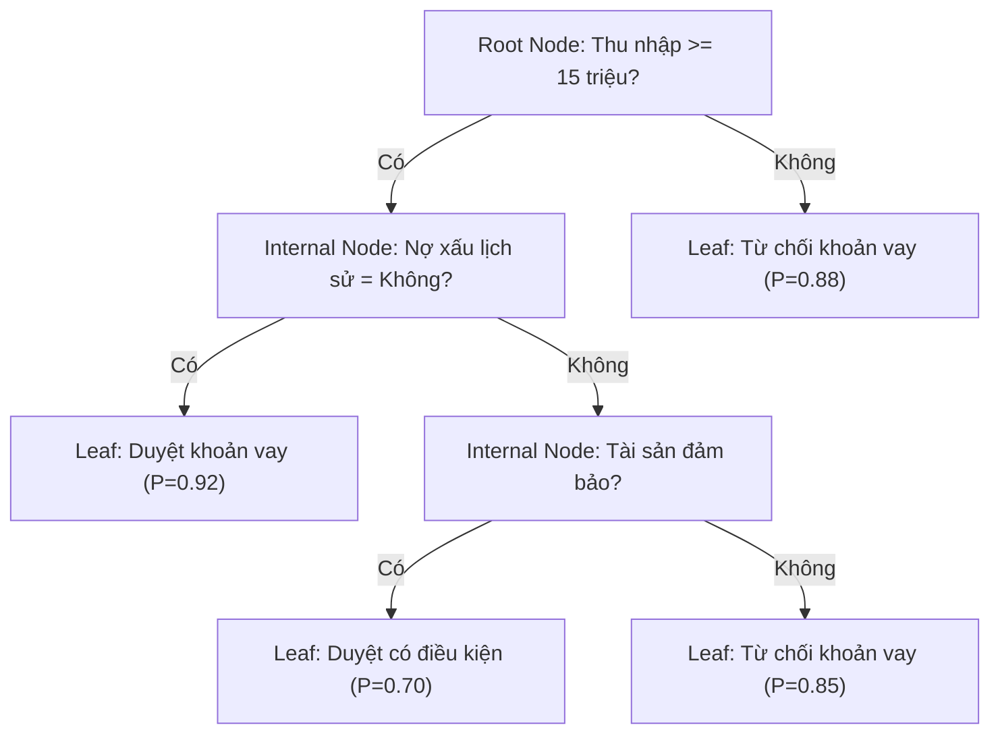

#DECISION TREE & RANDOM FOREST

> **Môn học / Chuyên đề:** Học máy ứng dụng (Applied Machine Learning) — Các mô hình dựa trên cây (Tree-based Models)  
> **Đối tượng:** Sinh viên Công nghệ Thông tin / Khoa học Dữ liệu, Kỹ sư phần mềm chuyển hướng AI/ML
> **Thời lượng đề xuất:** 4 buổi học (12 giờ lý thuyết + thực hành có hướng dẫn) và 1 Đồ án thực hành (Mini-Project)  
> **Tài liệu thực hành đi kèm:** `Project_Decision_Tree_Random_Forest.ipynb`

---

## MỤC LỤC

1. [Tổng quan khóa học & Lộ trình giảng dạy](#1-tổng-quan-khóa-học--lộ-trình-giảng-dạy)
2. [Chương 1: Tổng quan & Trực giác về Cây Quyết Định (Decision Tree)](#chương-1-tổng-quan--trực-giác-về-cây-quyết-định-decision-tree)
3. [Chương 2: Cơ sở Toán học & Các Tiêu chí Phân nhánh (Splitting Criteria)](#chương-2-cơ-sở-toán-học--các-tiêu-chí-phân-nhánh-splitting-criteria)
4. [Chương 3: Các Thuật toán Xây dựng Cây & Xử lý Đặc trưng](#chương-3-các-thuật-toán-xây-dựng-cây--xử-lý-đặc-trưng)
5. [Chương 4: Overfitting, Cắt tỉa Cây (Pruning) & Sự bất ổn định](#chương-4-overfitting-cắt-tỉa-cây-pruning--sự-bất-ổn-định)
6. [Chương 5: Ensemble Learning & Rừng Ngẫu Nhiên (Random Forest)](#chương-5-ensemble-learning--rừng-ngẫu-nhiên-random-forest)
7. [Chương 6: Diễn giải Mô hình, Tinh chỉnh Siêu tham số & Best Practices](#chương-6-diễn-giải-mô-hình-tinh-chỉnh-siêu-tham-số--best-practices)
8. [Chương 7: So sánh Toàn diện Decision Tree vs. Random Forest](#chương-7-so-sánh-toàn-diện-decision-tree-vs-random-forest)
9. [Chương 8: Ngân hàng Câu hỏi Ôn tập, Bài tập & Hướng dẫn Project](#chương-8-ngân-hàng-câu-hỏi-ôn-tập-bài-tập--hướng-dẫn-project)
10. [Tài liệu tham khảo](#tài-liệu-tham-khảo)

---

## 1. Tổng quan khóa học & Lộ trình giảng dạy

### 1.1. Kiến thức tiên quyết
- **Toán học:** Xác suất cơ bản (xác suất có điều kiện, kỳ vọng, phương sai), logarit, đạo hàm cơ bản.
- **Lập trình:** Python cơ bản, thao tác mảng/bảng với `NumPy`, `Pandas`, trực quan hóa với `Matplotlib`.
- **Học máy nền tảng:** Khái niệm Supervised Learning (Classification vs. Regression), Train/Validation/Test split, Cross-Validation, các độ đo đánh giá (Accuracy, Precision, Recall, F1, ROC-AUC, MSE, RMSE, $R^2$).

### 1.2. Mục tiêu đầu ra (Learning Outcomes)
Sau khi hoàn thành giáo trình và project thực hành, học viên có thể:
1. **Giải thích bản chất hình học và toán học** của Decision Tree cho cả bài toán phân loại và hồi quy.
2. **Tính tay được** Gini Impurity, Entropy, Information Gain, Variance Reduction và mô phỏng quá trình xây dựng cây CART từng bước.
3. **Phân tích nguyên nhân Overfitting** ở cây quyết định và áp dụng thành thạo Pre-pruning lẫn Post-pruning (Cost-Complexity Pruning).
4. **Chứng minh trực quan và toán học** lý do Random Forest (Bagging + Feature Subsampling) giảm phương sai hiệu quả hơn cây đơn lẻ.
5. **Diễn giải mô hình** bằng Mean Decrease in Impurity (MDI), Permutation Importance và hiểu các cạm bẫy thực tế (thiên vị đặc trưng, không ngoại suy được, rò rỉ dữ liệu).
6. **Xây dựng pipeline học máy hoàn chỉnh** bằng `scikit-learn` (từ EDA, tiền xử lý, xây dựng mô hình tự viết `from scratch`, tinh chỉnh siêu tham số đến đánh giá và phân tích lỗi).

### 1.3. Kế hoạch giảng dạy (4 buổi × 3 giờ)

| Buổi | Nội dung chính | Hoạt động trên lớp |
| :--- | :--- | :--- |
| **Buổi 1** | Chương 1 & Chương 2: Trực giác Decision Tree, Gini, Entropy, Information Gain, MSE/MAE | Bài tập tính tay chia nút gốc trên bảng dữ liệu nhỏ; vẽ ranh giới quyết định (decision boundary) |
| **Buổi 2** | Chương 3 & Chương 4: ID3/C4.5/CART, xử lý biến liên tục/phân loại/thiếu, Overfitting & Pruning (`ccp_alpha`) | Cài đặt Decision Tree từ đầu bằng NumPy; thí nghiệm thay đổi `max_depth` và `ccp_alpha` |
| **Buổi 3** | Chương 5: Bias–Variance Tradeoff, Bagging, Bootstrap, OOB Error, Feature Subsampling, Random Forest & Extra-Trees | Chứng minh công thức phương sai Ensemble; mô phỏng bootstrap và theo dõi đường cong OOB theo `n_estimators` |
| **Buổi 4** | Chương 6, 7 & 8: MDI vs. Permutation Importance, Tuning, Imbalanced Data, Best Practices & Chữa Project | Thực hành trọn vẹn Notebook `Project_Decision_Tree_Random_Forest.ipynb` và thảo luận lỗi sai thực tế |

---

## Chương 1: Tổng quan & Trực giác về Cây Quyết Định (Decision Tree)

### 1.1. Decision Tree là gì?
**Decision Tree (Cây quyết định)** là một thuật toán học máy có giám sát (Supervised Learning) phi tham số (Non-parametric), được sử dụng cho cả hai bài toán **Phân loại (Classification)** và **Hồi quy (Regression)**.

Cây quyết định mô phỏng cách con người ra quyết định thông qua một chuỗi các câu hỏi **Nếu – Thì (`IF – THEN`)** phân cấp:
- Mỗi câu hỏi kiểm tra một đặc trưng (feature) so với một ngưỡng (threshold) hoặc giá trị phân loại.
- Đi từ trên xuống dưới cho đến khi chạm một kết luận cuối cùng.



### 1.2. Thuật ngữ cấu trúc cây
- **Root Node (Nút gốc):** Nút trên cùng chứa toàn bộ tập dữ liệu huấn luyện; đại diện cho đặc trưng phân tách tốt nhất ở bước đầu tiên.
- **Internal / Decision Node (Nút trong / Nút quyết định):** Nút thực hiện phép kiểm tra điều kiện (ví dụ $x_j \le t$) và tiếp tục chia dữ liệu thành các nút con.
- **Branch / Edge (Nhánh):** Kết quả của điều kiện kiểm tra dẫn tới nút con.
- **Leaf / Terminal Node (Nút lá):** Nút cuối cùng không phân tách nữa, đưa ra giá trị dự đoán:
  - *Phân loại:* Nhãn lớp chiếm đa số (majority class) hoặc phân phối xác suất các lớp trong nút lá.
  - *Hồi quy:* Giá trị trung bình (với MSE) hoặc trung vị (với MAE) của biến mục tiêu $y$ trong nút lá.
- **Depth (Độ sâu của cây):** Độ dài đường đi dài nhất từ nút gốc đến một nút lá (nút gốc có độ sâu = 0).

### 1.3. Góc nhìn Hình học: Phân hoạch Không gian Đặc trưng
Về mặt hình học, một cây quyết định nhị phân (như CART) chia không gian đặc trưng $\mathbb{R}^d$ thành $M$ vùng hình chữ nhật siêu phẳng không giao nhau $R_1, R_2, \dots, R_M$ có các cạnh **song song với các trục tọa độ** (axis-aligned splits).

Hàm dự đoán của cây có dạng hàm hằng từng khúc (piecewise constant function):

$$\hat{f}(x) = \sum_{m=1}^{M} c_m \cdot \mathbb{I}(x \in R_m)$$

Trong đó $\mathbb{I}(x \in R_m) = 1$ nếu $x \in R_m$ và $0$ nếu ngược lại, còn $c_m$ là giá trị dự đoán tại vùng (nút lá) $R_m$.

> **Hệ quả quan trọng (Ghi chú giảng dạy):**
> 1. Cây quyết định **bất biến với phép biến đổi đơn điệu** của từng đặc trưng (như chuẩn hóa Min-Max, StandardScaler, biến đổi $\log$) vì nó chỉ quan tâm đến thứ tự so sánh $x_j \le t$.
> 2. Tuy nhiên, nếu ranh giới thực tế của dữ liệu là một đường chéo (ví dụ $x_1 + x_2 > 1$), cây quyết định phải tạo ra hình bậc thang gồm rất nhiều vết cắt song song trục tọa độ để xấp xỉ, dẫn đến cây sâu và dễ overfitting.

### 1.4. Ưu điểm và Hạn chế của Decision Tree
| Ưu điểm | Hạn chế |
| :--- | :--- |
| Dễ hiểu, dễ trực quan hóa, giải thích được cho người không chuyên (White-box model). | Rất dễ **Overfitting** nếu để cây phát triển tự do. |
| Không cần chuẩn hóa dữ liệu (Feature Scaling). | **Phương sai cao (High Variance):** Thay đổi nhỏ ở dữ liệu train có thể tạo ra một cây hoàn toàn khác. |
| Tự động nắm bắt quan hệ phi tuyến và tương tác giữa các đặc trưng. | Ranh giới dạng bậc thang, khó xấp xỉ ranh giới tuyến tính chéo mượt mà. |
| Xử lý tốt cả biến số và biến phân loại (tùy cài đặt thuật toán). | **Không có khả năng ngoại suy (Extrapolation)** trong bài toán hồi quy (dự đoán ngoài miền train luôn bị kẹp trong khoảng giá trị nút lá biên). |

---

## Chương 2: Cơ sở Toán học & Các Tiêu chí Phân nhánh (Splitting Criteria)

Làm thế nào để thuật toán chọn được cặp *(đặc trưng $j$, ngưỡng $t$)* tốt nhất tại mỗi nút?  
Nguyên tắc cốt lõi: **Chọn phép chia sao cho các nút con thu được "thuần khiết" (pure) nhất có thể** — tức các mẫu trong cùng một nút con càng giống nhau về nhãn $y$ càng tốt.

### 2.1. Tiêu chí cho Bài toán Phân loại (Classification)

Giả sử tại nút $S$ có $N$ mẫu thuộc $K$ lớp $1, 2, \dots, K$. Gọi $p_k = \frac{N_k}{N}$ là tỷ lệ mẫu thuộc lớp $k$ tại nút $S$ (với $\sum_{k=1}^{K} p_k = 1$).

#### a) Gini Impurity (Độ vẩn đục Gini) — Mặc định của CART / `scikit-learn`

$$G(S) = 1 - \sum_{k=1}^{K} p_k^2$$

- **Ý nghĩa xác suất:** Nếu chọn ngẫu nhiên một mẫu trong nút $S$ và gán nhãn ngẫu nhiên theo phân phối lớp của nút $S$, $G(S)$ chính là xác suất gán sai nhãn.
- **Miền giá trị:**
  - $G(S) = 0$: Nút hoàn toàn thuần khiết (chỉ chứa duy nhất 1 lớp, $p_k = 1$).
  - $G(S) = 1 - \frac{1}{K}$: Độ hỗn loạn cực đại khi các lớp phân bố đều nhau ($p_k = \frac{1}{K}$). Với bài toán nhị phân ($K=2$), $G_{\max} = 0.5$.

**Độ giảm Gini (Gini Gain / Impurity Decrease)** khi chia nút $S$ thành nút trái $S_L$ ($N_L$ mẫu) và nút phải $S_R$ ($N_R$ mẫu):

$$\Delta G(S, j, t) = G(S) - \left( \frac{N_L}{N} G(S_L) + \frac{N_R}{N} G(S_R) \right)$$

Thuật toán chọn $(j^*, t^*)$ để **cực đại hóa** $\Delta G$ (tương đương cực tiểu hóa tổng Gini có trọng số của hai nút con).

#### b) Entropy (Shannon Entropy) & Information Gain (IG) — ID3 / C4.5

$$H(S) = - \sum_{k=1}^{K} p_k \log_2(p_k) \quad (\text{quy ước } 0 \log_2 0 = 0)$$

- **Ý nghĩa lý thuyết thông tin:** Số bit trung bình tối thiểu cần thiết để mã hóa nhãn lớp của một mẫu chọn ngẫu nhiên từ $S$.
- **Miền giá trị:** $H(S) \in [0, \log_2 K]$. Với $K=2$, $H(S) \in [0, 1]$ (đạt $1$ khi tỷ lệ là $50/50$).

**Information Gain (Độ lợi thông tin)** khi chia $S$ theo thuộc tính $A$ thành các tập con $S_1, S_2, \dots, S_v$:

$$\text{IG}(S, A) = H(S) - \sum_{i=1}^{v} \frac{|S_i|}{|S|} H(S_i)$$

#### c) Gain Ratio (Tỷ số độ lợi thông tin) — Cải tiến của C4.5
**Vấn đề của Information Gain:** IG có xu hướng thiên vị các thuộc tính có rất nhiều giá trị riêng biệt (High Cardinality), ví dụ cột `Ma_Khach_Hang` sẽ chia mỗi khách hàng thành 1 nút lá thuần khiết hoàn toàn ($H=0$), đạt IG tối đa nhưng hoàn toàn vô nghĩa để tổng quát hóa!

Thuật toán C4.5 khắc phục bằng cách chuẩn hóa IG theo **Split Information** (độ phân tán của chính phép chia):

$$\text{SplitInfo}(S, A) = - \sum_{i=1}^{v} \frac{|S_i|}{|S|} \log_2\left(\frac{|S_i|}{|S|}\right)$$

$$\text{GainRatio}(S, A) = \frac{\text{IG}(S, A)}{\text{SplitInfo}(S, A)}$$

#### d) So sánh Gini Impurity và Entropy
- Với bài toán nhị phân, nếu đặt $p = p_1$, đường cong $2 \cdot G(p) = 4p(1-p)$ gần như trùng khít với $H(p) = -p\log_2 p - (1-p)\log_2(1-p)$.
- **Tốc độ:** Gini nhanh hơn một chút vì không phải tính phép $\log$.
- **Hành vi:** Entropy có xu hướng tạo cây hơi cân bằng hơn một chút, trong khi Gini có xu hướng cô lập lớp phổ biến nhất sang một nhánh riêng. Tuy nhiên trong ~98% trường hợp thực tế, kết quả hai tiêu chí cho độ chính xác tương đương nhau.

---

### 2.2. Tiêu chí cho Bài toán Hồi quy (Regression)

Khi biến mục tiêu $y \in \mathbb{R}$ là số liên tục, ta không đo độ thuần khiết lớp mà đo **độ phân tán của $y$** trong từng nút.

#### a) MSE (Mean Squared Error) / Variance Reduction — Mặc định
Tại một nút $S$ gồm $N$ mẫu, giá trị hằng số $c$ tối ưu để cực tiểu hóa tổng bình phương sai số $\sum_{i \in S} (y_i - c)^2$ chính là **giá trị trung bình**:

$$\hat{y}_S = \bar{y}_S = \frac{1}{N} \sum_{i \in S} y_i$$

Độ lỗi (impurity) tại nút $S$:

$$\text{MSE}(S) = \frac{1}{N} \sum_{i \in S} (y_i - \bar{y}_S)^2 = \text{Var}(S)$$

Hàm mục tiêu chọn phép chia $(j, t)$ để cực tiểu hóa MSE có trọng số (hay cực đại hóa **Variance Reduction**):

$$\Delta \text{MSE}(S, j, t) = \text{MSE}(S) - \left( \frac{N_L}{N}\text{MSE}(S_L) + \frac{N_R}{N}\text{MSE}(S_R) \right)$$

#### b) MAE (Mean Absolute Error)
Khi dữ liệu có nhiều giá trị ngoại lai (outliers), MSE bình phương sai số nên bị kéo lệch mạnh. Thay vào đó có thể dùng MAE:

$$\text{MAE}(S) = \frac{1}{N} \sum_{i \in S} |y_i - \text{median}(y_S)|$$

Giá trị dự đoán tại nút lá lúc này là **trung vị (median)** của $y$ trong nút. Nhược điểm là chi phí tính toán khi tìm ngưỡng chia lớn hơn MSE đáng kể.

---

### 2.3. Ví dụ tính tay hoàn chỉnh (Worked Example trên lớp)

Xét tập dữ liệu $N = 10$ khách hàng đăng ký vay vốn với nhãn mục tiêu **Duyệt vay (`Có` / `Không`)**:

| ID | Thu nhập | Lịch sử tín dụng | Có tài sản | Duyệt vay ($y$) |
| :-: | :--- | :--- | :-: | :-: |
| 1 | Cao | Tốt | Có | **Có** |
| 2 | Cao | Tốt | Không | **Có** |
| 3 | Cao | Xấu | Có | **Có** |
| 4 | Trung bình | Tốt | Có | **Có** |
| 5 | Trung bình | Tốt | Không | **Có** |
| 6 | Trung bình | Xấu | Có | **Không** |
| 7 | Trung bình | Xấu | Không | **Không** |
| 8 | Thấp | Tốt | Có | **Có** |
| 9 | Thấp | Tốt | Không | **Không** |
| 10 | Thấp | Xấu | Không | **Không** |

**Bước 1: Tính Gini tại nút gốc $S$**
- Tổng cộng có 6 `Có` và 4 `Không` ($p_{\text{Có}} = 0.6$, $p_{\text{Không}} = 0.4$).
- $G(S) = 1 - (0.6^2 + 0.4^2) = 1 - (0.36 + 0.16) = \mathbf{0.48}$.

**Bước 2: Xét phép chia theo `Lịch sử tín dụng`**
- Nhánh `Tốt` (6 mẫu: ID 1, 2, 4, 5, 8, 9 → 5 `Có`, 1 `Không`):
  $$G(\text{Tốt}) = 1 - \left(\left(\frac{5}{6}\right)^2 + \left(\frac{1}{6}\right)^2\right) = 1 - \frac{26}{36} = \frac{10}{36} \approx 0.278$$
- Nhánh `Xấu` (4 mẫu: ID 3, 6, 7, 10 → 1 `Có`, 3 `Không`):
  $$G(\text{Xấu}) = 1 - \left(\left(\frac{1}{4}\right)^2 + \left(\frac{3}{4}\right)^2\right) = 1 - \frac{10}{16} = 0.375$$
- Gini có trọng số sau chia:
  $$G_{\text{split}}(\text{Lịch sử}) = \frac{6}{10}(0.278) + \frac{4}{10}(0.375) = 0.167 + 0.150 = \mathbf{0.317}$$
- Độ giảm Gini: $\Delta G = 0.48 - 0.317 = \mathbf{0.163}$.

**Bước 3: Xét phép chia theo `Có tài sản`**
- Nhánh `Có` (5 mẫu: ID 1, 3, 4, 6, 8 → 4 `Có`, 1 `Không`): $G = 1 - (0.8^2 + 0.2^2) = 0.32$.
- Nhánh `Không` (5 mẫu: ID 2, 5, 7, 9, 10 → 2 `Có`, 3 `Không`): $G = 1 - (0.4^2 + 0.6^2) = 0.48$.
- $G_{\text{split}}(\text{Tài sản}) = 0.5(0.32) + 0.5(0.48) = \mathbf{0.400} \implies \Delta G = 0.48 - 0.40 = \mathbf{0.080}$.

**Bước 4: Xét phép chia nhị phân theo `Thu nhập` (ví dụ `Cao` vs `Không Cao`)**
- Nhánh `Cao` (3 mẫu: ID 1, 2, 3 → 3 `Có`, 0 `Không`): $G = 0$.
- Nhánh `Không Cao` (7 mẫu → 3 `Có`, 4 `Không`): $G = 1 - ((3/7)^2 + (4/7)^2) = 24/49 \approx 0.490$.
- $G_{\text{split}} = \frac{3}{10}(0) + \frac{7}{10}(0.490) = \mathbf{0.343} \implies \Delta G = 0.48 - 0.343 = \mathbf{0.137}$.

**Kết luận Bước 1:** Vì $\Delta G(\text{Lịch sử tín dụng}) = 0.163$ lớn nhất, ta chọn **`Lịch sử tín dụng`** làm **Nút gốc (Root Node)**, sau đó tiếp tục lặp đệ quy tương tự trên từng nhánh con `Tốt` và `Xấu` cho đến khi các nút thuần khiết ($G = 0$) hoặc đạt điều kiện dừng!

---

## Chương 3: Các Thuật toán Xây dựng Cây & Xử lý Đặc trưng

### 3.1. So sánh 3 họ thuật toán kinh điển: ID3, C4.5 và CART

| Tiêu chí | ID3 (Quinlan, 1986) | C4.5 (Quinlan, 1993) | CART (Breiman et al., 1984) |
| :--- | :--- | :--- | :--- |
| **Bài toán hỗ trợ** | Chỉ Classification | Chỉ Classification | Cả **Classification & Regression** |
| **Cấu trúc cây** | Đa nhánh (Multi-way) | Đa nhánh (Multi-way) | **Nhị phân (Binary Tree)** |
| **Tiêu chí chia** | Information Gain (Entropy) | Gain Ratio | Gini (Classification) / MSE (Regression) |
| **Biến liên tục** | Không hỗ trợ trực tiếp | Có (tìm ngưỡng nhị phân) | Có (tìm ngưỡng nhị phân) |
| **Giá trị thiếu** | Không hỗ trợ | Có (phân bổ trọng số xác suất) | Có (Surrogate splits / nhánh mặc định) |
| **Cắt tỉa (Pruning)** | Không | Có (Error-based Pruning) | Có (**Cost-Complexity Pruning**) |
| **Thư viện dùng** | Học thuật | Weka (J48) | **`scikit-learn`** (CART tối ưu) |

### 3.2. Mã giả thuật toán CART (Top-Down Greedy Recursive Binary Splitting)

```text
Function BuildTree(D, depth):
    1. Kiểm tra điều kiện dừng (Stopping Criteria):
       - Nếu tất cả mẫu trong D có cùng nhãn y (impurity == 0), HOẶC
       - depth >= max_depth, HOẶC
       - |D| < min_samples_split, HOẶC
       - Không tìm được phép chia nào có độ giảm impurity > min_impurity_decrease:
         -> Trả về LeafNode(prediction = MajorityClass(D) hoặc Mean(D))

    2. Khởi tạo best_gain = -∞, best_split = None
    3. Với mỗi đặc trưng j trong tập đặc trưng cần xét:
       - Lấy danh sách các ngưỡng ứng viên T_j (trung điểm các giá trị đã sắp xếp)
       - Với mỗi ngưỡng t trong T_j:
           D_left  = { (x, y) ∈ D : x[j] <= t }
           D_right = { (x, y) ∈ D : x[j] >  t }
           Nếu |D_left| < min_samples_leaf hoặc |D_right| < min_samples_leaf:
               Bỏ qua
           gain = Impurity(D) - (|D_left|/|D|)*Impurity(D_left) - (|D_right|/|D|)*Impurity(D_right)
           Nếu gain > best_gain:
               best_gain = gain
               best_split = (j, t, D_left, D_right)

    4. Nếu best_split là None hoặc best_gain <= min_impurity_decrease:
       -> Trả về LeafNode(prediction)

    5. Đệ quy xây cây con:
       left_child  = BuildTree(best_split.D_left,  depth + 1)
       right_child = BuildTree(best_split.D_right, depth + 1)
       Trả về DecisionNode(feature=j, threshold=t, left=left_child, right=right_child)
```

> **Tại sao gọi là thuật toán Tham lam (Greedy)?**  
> Tìm cây quyết định tối ưu toàn cục (nhỏ nhất có lỗi thấp nhất) là bài toán **NP-Complete**. Do đó CART chọn phép chia tốt nhất cục bộ tại từng nút mà không nhìn trước các bước sâu hơn.

### 3.3. Xử lý các kiểu dữ liệu & Độ phức tạp tính toán

1. **Biến liên tục (Continuous features):**
   - Sắp xếp các giá trị duy nhất $v_1 < v_2 < \dots < v_m$ của đặc trưng $j$.
   - Thử các ngưỡng trung điểm $t_i = \frac{v_i + v_{i+1}}{2}$ (tối ưu hơn: chỉ cần thử các vị trí nơi nhãn $y$ thay đổi trong phân loại).
2. **Biến phân loại (Categorical features):**
   - Trong `scikit-learn`: Yêu cầu mã hóa số trước (`OneHotEncoder` cho biến định danh ít giá trị, `OrdinalEncoder` cho biến thứ bậc, hoặc `TargetEncoder` cho biến nhiều giá trị).
   - Lưu ý: One-Hot Encoding trên biến quá nhiều giá trị (ví dụ 100 tỉnh/thành) tạo ra ma trận thưa, dễ làm loãng độ quan trọng của đặc trưng và giảm hiệu quả chọn đặc trưng ngẫu nhiên ở Random Forest.
3. **Giá trị thiếu (Missing Values):**
   - Cách chuẩn mực với `scikit-learn`: Dùng `SimpleImputer` (median/most_frequent + `add_indicator=True` để giữ lại thông tin "bị thiếu") đặt trong `Pipeline`.
   - Từ `scikit-learn >= 1.3`, `DecisionTreeClassifier/Regressor` đã hỗ trợ native missing values (tự học hướng rẽ tối ưu cho `NaN`).
4. **Độ phức tạp tính toán (Complexity):**
   - **Huấn luyện (Training):** $O(d \cdot n \log n \cdot \text{depth})$ (hay gần $O(d \cdot n \log n)$ khi sắp xếp trước hoặc phân bổ đều qua các tầng), với $n$ là số mẫu, $d$ là số đặc trưng.
   - **Dự đoán (Inference):** $O(\text{depth}) \approx O(\log n)$ cho một mẫu — **cực kỳ nhanh** trong môi trường production!

---

## Chương 4: Overfitting, Cắt tỉa Cây (Pruning) & Sự bất ổn định

### 4.1. Bias–Variance Tradeoff trên Cây Quyết Định
Nếu không đặt bất kỳ giới hạn nào, một cây quyết định sẽ chia nhỏ dữ liệu cho tới khi **mỗi nút lá chỉ còn 1 mẫu** (hoặc tất cả mẫu trong lá cùng nhãn):
- **Train Error $\approx 0$** (Low Bias — gần như học thuộc lòng cả nhiễu).
- **Test Error rất cao** (High Variance — kém tổng quát hóa).

Ngược lại, một cây quá nông (ví dụ `max_depth=1`, gọi là **Decision Stump**) không đủ năng lực biểu diễn quan hệ phức tạp → **Underfitting** (High Bias, Low Variance).

### 4.2. Tiền cắt tỉa (Pre-pruning / Early Stopping)
Dừng quá trình mọc cây sớm bằng các siêu tham số điều chuẩn (regularization):
- `max_depth`: Giới hạn độ sâu tối đa của cây (tham số có tác động trực quan và mạnh nhất).
- `min_samples_split`: Số mẫu tối thiểu cần có ở một nút để được phép chia tiếp.
- `min_samples_leaf`: Số mẫu tối thiểu bắt buộc phải có ở mỗi nút lá sau khi chia (rất hiệu quả để làm mượt dự đoán hồi quy và chống nhiễu).
- `max_leaf_nodes`: Giới hạn tổng số nút lá tối đa (xây cây theo thứ tự giảm impurity tốt nhất — best-first).
- `min_impurity_decrease`: Chỉ chia nút nếu độ giảm impurity lớn hơn ngưỡng này.

> **Hạn chế của Pre-pruning (Horizon Effect):** Đôi khi một phép chia hiện tại có độ giảm impurity nhỏ, nhưng nó lại mở đường cho một phép chia rất mạnh ở tầng ngay sau đó (ví dụ bài toán XOR). Dừng sớm có thể bỏ lỡ cấu trúc này.

### 4.3. Hậu cắt tỉa (Post-pruning — Minimal Cost-Complexity Pruning)
Để khắc phục Horizon Effect, ta **cho cây mọc đầy đủ trước**, sau đó cắt tỉa ngược từ dưới lên dựa trên hàm chi phí kết hợp giữa sai số và độ phức tạp (số lượng nút lá $|T|$):

$$R_\alpha(T) = R(T) + \alpha |T|$$

Trong đó:
- $R(T)$: Tổng impurity có trọng số trên tất cả các nút lá của cây con $T$.
- $|T|$: Số lượng nút lá của cây $T$.
- $\alpha \ge 0$ (`ccp_alpha` trong `scikit-learn`): Hệ số phạt độ phức tạp.
  - Khi $\alpha = 0$: Giữ nguyên cây đầy đủ.
  - Khi $\alpha$ tăng dần: Các nhánh con có độ giảm impurity trên mỗi nút lá cắt bỏ thấp nhất sẽ lần lượt bị cắt gộp về nút cha.

**Quy trình chuẩn chọn `ccp_alpha`:**
1. Gọi `path = clf.cost_complexity_pruning_path(X_train, y_train)` để lấy dãy các giá trị `ccp_alphas` tới hạn.
2. Huấn luyện hoặc chạy Cross-Validation trên từng giá trị $\alpha$ trong dãy này.
3. Chọn $\alpha^*$ cho điểm Validation cao nhất (hoặc áp dụng quy tắc 1-SE để chọn cây đơn giản nhất trong phạm vi 1 độ lệch chuẩn).

### 4.4. Điểm yếu chí mạng của Cây đơn lẻ: High Variance
Ngay cả khi đã cắt tỉa tốt, một cây quyết định đơn lẻ vẫn rất **nhạy cảm với tập dữ liệu huấn luyện**: chỉ cần bỏ đi hoặc thay đổi 5% số mẫu huấn luyện, nút gốc có thể chọn đặc trưng khác, kéo theo toàn bộ cấu trúc cây bên dưới thay đổi hoàn toàn.

→ **Câu hỏi đặt ra:** *Nếu mỗi cây đơn lẻ có Low Bias nhưng High Variance, làm sao để giữ nguyên khả năng học phi tuyến mạnh mẽ mà giảm mạnh Variance?*  
→ **Câu trả lời:** Kết hợp hàng trăm cây đa dạng lại với nhau — **Random Forest**!

---

## Chương 5: Ensemble Learning & Rừng Ngẫu Nhiên (Random Forest)

### 5.1. Nguyên lý "Trí tuệ Đám đông" & Chứng minh Toán học

Giả sử ta có $B$ mô hình (cây) $\hat{f}_1(x), \hat{f}_2(x), \dots, \hat{f}_B(x)$ cùng có phương sai $\text{Var}(\hat{f}_b(x)) = \sigma^2$, và bất kỳ hai cây nào cũng có hệ số tương quan cặp (pairwise correlation) bằng $\rho \in [0, 1]$.

Phương sai của dự đoán trung bình $\bar{f}(x) = \frac{1}{B} \sum_{b=1}^{B} \hat{f}_b(x)$ là:

$$\text{Var}(\bar{f}(x)) = \text{Var}\left(\frac{1}{B} \sum_{b=1}^{B} \hat{f}_b(x)\right) = \frac{1}{B^2} \left( \sum_{b=1}^{B} \text{Var}(\hat{f}_b) + \sum_{b \neq b'} \text{Cov}(\hat{f}_b, \hat{f}_{b'}) \right)$$

$$= \frac{1}{B^2} \left( B \sigma^2 + B(B-1) \rho \sigma^2 \right) = \rho \sigma^2 + \frac{1 - \rho}{B} \sigma^2$$

> **Phân tích công thức vàng của Random Forest:**
> 1. **Số hạng thứ hai $\frac{1-\rho}{B}\sigma^2$:** Khi tăng số lượng cây $B$ (`n_estimators`) lên lớn ($100, 300, 500, \dots$), số hạng này tiến về $0$. (Lưu ý: Tăng $B$ trong Random Forest **không làm tăng Overfitting**, chỉ tăng thời gian tính toán cho đến khi lỗi hội tụ!).
> 2. **Số hạng thứ nhất $\rho \sigma^2$:** Không biến mất dù $B \to \infty$! Nếu các cây quá giống nhau ($\rho \approx 1$), phương sai hầu như không giảm.
> 3. **Hai vũ khí của Random Forest (Leo Breiman, 2001):**
>    - **Bagging (Bootstrap Aggregating):** Tạo dữ liệu khác nhau cho mỗi cây và lấy trung bình để giảm số hạng $\frac{1-\rho}{B}\sigma^2$.
>    - **Feature Subsampling (Chọn ngẫu nhiên tập con đặc trưng tại mỗi nút):** Phá vỡ sự thống trị của một vài đặc trưng quá mạnh, giúp các cây **khác biệt nhau (decorrelate)** → giảm mạnh $\rho$!

---

### 5.2. Hai nguồn ngẫu nhiên cốt lõi của Random Forest

#### 1) Bootstrap Sampling (Lấy mẫu có hoàn lại theo dòng)
Với tập huấn luyện có $N$ mẫu, để xây dựng cây thứ $b$, ta bốc ngẫu nhiên **$N$ mẫu có hoàn lại (sampling with replacement)** từ tập gốc để tạo tập bootstrap $D_b$.
- Một số mẫu sẽ xuất hiện lặp lại 2, 3 lần trong $D_b$.
- Một số mẫu sẽ **không xuất hiện lần nào** trong $D_b$ — gọi là các mẫu **Out-of-Bag (OOB)**.

**Xác suất một mẫu bất kỳ là OOB của một cây:**

$$P(\text{mẫu } i \notin D_b) = \left(1 - \frac{1}{N}\right)^N \xrightarrow{N \to \infty} \frac{1}{e} \approx 0.3679 \approx \mathbf{36.8\%}$$

Như vậy, trung bình mỗi cây được huấn luyện trên khoảng **63.2%** số mẫu duy nhất của tập train, và để lại **36.8%** làm tập kiểm tra tự nhiên!

#### 2) Feature Subsampling (Lấy mẫu ngẫu nhiên theo cột tại mỗi nút)
Thay vì xét toàn bộ $d$ đặc trưng tại mỗi nút chia như Bagged Trees thuần túy, Random Forest chỉ chọn ngẫu nhiên một tập con gồm $m$ đặc trưng (`max_features`) để tìm phép chia tốt nhất tại **mỗi nút**:
- **Phân loại (Classification):** Mặc định $m = \lfloor \sqrt{d} \rfloor$ (`max_features='sqrt'`).
- **Hồi quy (Regression):** Leo Breiman đề xuất $m = \lfloor d/3 \rfloor$; trong `scikit-learn` mặc định là `max_features=1.0` (bằng Bagging), do đó với bài toán hồi quy nên thử tuning `max_features` ở các mức `0.33`, `0.5`, `'sqrt'`, `1.0`.

*Tại sao cần chọn lại tập con đặc trưng ở **mỗi nút** chứ không phải ở cấp cây?*  
Vì một đặc trưng mạnh nếu bị bỏ qua ở nút gốc vẫn có cơ hội xuất hiện ở tầng sâu hơn, đồng thời mọi nhánh con đều có tính đa dạng cao hơn nhiều.

---

### 5.3. Đánh giá Out-of-Bag (OOB Error)
Với mỗi mẫu huấn luyện $x_i$, ta chỉ dùng **những cây mà $x_i$ nằm trong tập OOB** (trung bình khoảng $0.368 \times B$ cây) để đưa ra dự đoán tổng hợp $\hat{y}_i^{\text{OOB}}$, sau đó so sánh với nhãn thật $y_i$ trên toàn bộ $N$ mẫu.

- **Ưu điểm:** Cung cấp ước lượng lỗi tổng quát hóa gần tương đương k-Fold Cross-Validation mà **không cần tách riêng tập validation** hay huấn luyện lại $k$ lần!
- Trong `scikit-learn`, chỉ cần bật `oob_score=True` (khi `bootstrap=True`) và truy cập `rf.oob_score_`.

---

### 5.4. Tổng hợp dự đoán (Aggregation)
- **Phân loại:**
  - *Hard Voting:* Chọn lớp được nhiều cây bầu chọn nhất.
  - *Soft Voting (mặc định của `scikit-learn`):* Trung bình hóa xác suất dự đoán của $B$ cây:
    $$\hat{P}(y = k \mid x) = \frac{1}{B} \sum_{b=1}^{B} \hat{P}_b(y = k \mid x), \quad \hat{y} = \arg\max_k \hat{P}(y = k \mid x)$$
- **Hồi quy:** Lấy trung bình cộng dự đoán của $B$ cây:
  $$\hat{y}(x) = \frac{1}{B} \sum_{b=1}^{B} \hat{f}_b(x)$$

---

### 5.5. Mã giả thuật toán Random Forest

```text
Input: Tập huấn luyện D kích thước N với d đặc trưng, số cây B, số đặc trưng mỗi nút m
Output: Tập hợp rừng cây {T_1, T_2, ..., T_B}

For b = 1 to B:
    1. Tạo tập dữ liệu Bootstrap D_b kích thước N bằng cách lấy mẫu có hoàn lại từ D
    2. Xây dựng cây quyết định T_b (thường mọc sâu, không cắt tỉa) trên D_b:
       Tại mỗi nút chưa đạt điều kiện dừng:
         a) Chọn ngẫu nhiên không hoàn lại m đặc trưng từ d đặc trưng
         b) Tìm cặp (đặc trưng j*, ngưỡng t*) tốt nhất CHỈ TRONG m đặc trưng đó
         c) Chia nút thành hai nút con trái và phải
End For

Dự đoán cho mẫu mới x:
    - Classification: Trung bình phân phối xác suất của B cây -> argmax
    - Regression:     (1/B) * Σ T_b(x)
```

---

### 5.6. Mở rộng: Extra-Trees & Vị trí của Random Forest trong họ Ensemble

1. **Extra-Trees (Extremely Randomized Trees):**
   - Tăng độ ngẫu nhiên lên một bước nữa: Thay vì tìm ngưỡng $t^*$ tối ưu cho từng đặc trưng trong $m$ đặc trưng, Extra-Trees **chọn ngẫu nhiên các ngưỡng cắt** rồi chọn ngưỡng tốt nhất trong số đó (thường dùng toàn bộ dữ liệu thay vì bootstrap).
   - *Hệ quả:* Huấn luyện nhanh hơn Random Forest, phương sai giảm thêm nữa nhưng độ lệch (Bias) có thể tăng nhẹ.
2. **Bagging (Random Forest) vs. Boosting (XGBoost / LightGBM / CatBoost):**
   - **Random Forest (Bagging):** Các cây độc lập, huấn luyện **song song**; dùng các cây sâu (Low Bias, High Variance) rồi trung bình hóa để **giảm Variance**. Rất dễ tune, bền vững với nhiễu, ít khi overfit nặng.
   - **Gradient Boosting:** Các cây huấn luyện **tuần tự**, cây sau sửa sai số (residual/gradient) của cây trước; dùng các cây nông (High Bias, Low Variance) để **giảm Bias**. Thường đạt độ chính xác nhỉnh hơn trên dữ liệu dạng bảng (tabular data) nhưng nhạy cảm với nhiễu và cần tinh chỉnh kỹ hơn.

---

## Chương 6: Diễn giải Mô hình, Tinh chỉnh Siêu tham số & Best Practices

### 6.1. Độ quan trọng của Đặc trưng (Feature Importance)

Vì Random Forest gồm hàng trăm cây, ta không còn nhìn được một cây duy nhất như Decision Tree (chuyển từ White-box sang Gray-box). Để giải thích mô hình, có 3 kỹ thuật chủ đạo:

#### a) Mean Decrease in Impurity (MDI / Gini Importance) — `model.feature_importances_`
- Tính tổng mức giảm impurity có trọng số (theo tỷ lệ mẫu đi qua nút) mỗi khi đặc trưng $j$ được dùng để phân nhánh, sau đó trung bình qua tất cả $B$ cây và chuẩn hóa để tổng bằng $1$.
- **Ưu điểm:** Tính sẵn ngay trong quá trình huấn luyện (tốn chi phí bằng 0).
- **Cảnh báo quan trọng (Pitfall):**
  1. **Thiên vị các biến liên tục hoặc biến phân loại có nhiều giá trị (High Cardinality):** Vì chúng có nhiều điểm cắt ứng viên hơn nên dễ đạt mức giảm impurity ngẫu nhiên cao trên tập train (ngay cả một biến nhiễu ngẫu nhiên hoàn toàn cũng có thể có MDI cao!).
  2. Tính trên tập **Train**, nên phản ánh những gì cây dùng để fit dữ liệu train chứ không hẳn là những gì giúp tổng quát hóa trên tập Test.

#### b) Permutation Importance (MDA — Mean Decrease in Accuracy/Score)
- Cách tính trên tập **Validation / Test**:
  1. Tính điểm baseline $S_0$ của mô hình trên tập validation.
  2. Xáo trộn ngẫu nhiên các giá trị trong cột $j$ (phá vỡ mối liên hệ giữa cột $j$ và nhãn $y$ nhưng giữ nguyên phân phối biên của cột $j$), giữ nguyên các cột khác.
  3. Tính lại điểm $S_j$. Độ quan trọng = $S_0 - S_j$ (lặp lại nhiều lần để lấy trung bình và độ lệch chuẩn).
- **Ưu điểm:** Không thiên vị biến nhiều giá trị, đo trực tiếp đóng góp vào khả năng **tổng quát hóa** trên dữ liệu chưa thấy.
- **Lưu ý:** Nếu hai đặc trưng có **đa cộng tuyến cao (high collinearity)**, khi xáo trộn một đặc trưng, mô hình vẫn dựa vào đặc trưng còn lại nên điểm Permutation Importance của cả hai có thể bị giảm thấp giả tạo.

#### c) SHAP (TreeSHAP) — Diễn giải toàn cục & cục bộ
- Dựa trên Lý thuyết trò chơi hợp tác (Shapley Values), `TreeSHAP` tính đóng góp chính xác của từng đặc trưng cho **từng dự đoán cụ thể** (ví dụ: *Tại sao khách hàng A bị từ chối vay?* — Nợ xấu đẩy xác suất giảm 0.35, Thu nhập cao đẩy tăng 0.12).

---

### 6.2. Cẩm nang Tinh chỉnh Siêu tham số (Hyperparameter Tuning Guide)

| Siêu tham số | Ý nghĩa | Chiến lược tinh chỉnh thực tế |
| :--- | :--- | :--- |
| `n_estimators` | Số lượng cây trong rừng | Càng lớn càng ổn định (thường `100`–`500`). Chọn điểm mà đường cong OOB Error đi ngang. |
| `max_features` | Số đặc trưng xét ở mỗi nút | Quan trọng nhất để giảm tương quan $\rho$. Thử `'sqrt'`, `'log2'`, `0.3`, `0.5`, `0.8`. |
| `max_depth` | Độ sâu tối đa mỗi cây | Mặc định `None` (mọc đầy đủ) thường đã tốt cho RF, nhưng với dữ liệu nhiễu nên thử `6`, `10`, `15`, `20`. |
| `min_samples_leaf` | Số mẫu tối thiểu tại mỗi lá | Tham số điều chuẩn rất hiệu quả và mượt (`1`, `2`, `5`, `10`, `20`). |
| `min_samples_split` | Số mẫu tối thiểu để chia nút | Thường thử `2`, `5`, `10`, `20`. |
| `class_weight` | Trọng số cho các lớp | Dùng `'balanced'` hoặc `'balanced_subsample'` khi dữ liệu mất cân bằng lớp. |
| `max_samples` | Tỷ lệ mẫu bootstrap cho mỗi cây | Giảm xuống `0.6`–`0.8` giúp tăng tốc và giảm tương quan giữa các cây trên tập dữ liệu rất lớn. |

**Mẹo tìm kiếm:** Sử dụng `RandomizedSearchCV` trên không gian rộng trước để thu hẹp vùng tối ưu, sau đó dùng `GridSearchCV` tinh chỉnh mịn xung quanh vùng đó, luôn kết hợp `StratifiedKFold` (cho phân loại) và `n_jobs=-1`.

---

### 6.3. Những sai lầm thường gặp (Common Pitfalls) & Best Practices

1. **Rò rỉ dữ liệu (Data Leakage):**
   - *Sai:* Impute, Target Encode hay SMOTE trên toàn bộ dữ liệu rồi mới chia Train/Test.
   - *Đúng:* Luôn bọc toàn bộ bước tiền xử lý và mô hình vào `sklearn.pipeline.Pipeline` và `ColumnTransformer`.
2. **Dùng Accuracy cho dữ liệu mất cân bằng:**
   - Ví dụ gian lận thẻ tín dụng chiếm 1%: một mô hình đoán tất cả là "Không gian lận" vẫn đạt 99% Accuracy!
   - *Đúng:* Đánh giá bằng **PR-AUC (Average Precision)**, **ROC-AUC**, **Recall**, **F1-score**, và điều chỉnh ngưỡng quyết định (Decision Threshold Tuning) thay vì giữ cứng ngưỡng `0.5`.
3. **Kỳ vọng Cây / Random Forest ngoại suy (Extrapolation):**
   - Trong bài toán hồi quy (ví dụ dự báo doanh số tăng trưởng theo thời gian), dự đoán của Random Forest luôn là trung bình của các giá trị $y$ trong tập Train → **không bao giờ dự đoán được giá trị lớn hơn $\max(y_{\text{train}})$ hoặc nhỏ hơn $\min(y_{\text{train}})$**.
   - *Giải pháp:* Biến đổi bài toán sang dự đoán mức tăng trưởng/sai phân ($\Delta y$), khử xu hướng tuyến tính trước, hoặc dùng mô hình tuyến tính/lai.
4. **Hiệu chuẩn xác suất (Probability Calibration):**
   - Cây đơn lẻ thường đưa xác suất cực đoan (`0.0` hoặc `1.0`), còn Random Forest đôi khi bị đẩy xác suất về giữa (do trung bình nhiều cây). Nếu ứng dụng cần xác suất chính xác (ví dụ tính rủi ro tài chính), hãy kiểm tra Calibration Curve và dùng `CalibratedClassifierCV`.

---

## Chương 7: So sánh Toàn diện Decision Tree vs. Random Forest

| Tiêu chí | Decision Tree (Cây đơn lẻ) | Random Forest (Rừng ngẫu nhiên) |
| :--- | :--- | :--- |
| **Bản chất** | Mô hình đơn lẻ (Single Learner) | Học kết hợp (Bagging Ensemble) |
| **Độ chính xác tổng quát** | Trung bình – Khá | Cao – Rất cao trên dữ liệu dạng bảng |
| **Bias / Variance** | Low Bias, **High Variance** (khi sâu) | Low Bias, **Low Variance** |
| **Khả năng Overfitting** | Rất dễ Overfit nếu không cắt tỉa kỹ | Kháng Overfit tốt nhờ lấy trung bình |
| **Độ ổn định** | Thấp (nhạy cảm với thay đổi nhỏ) | Rất cao |
| **Khả năng diễn giải** | **Rất cao** (vẽ được toàn bộ luật IF-THEN) | Trung bình (dùng MDI, Permutation Importance, SHAP) |
| **Tốc độ huấn luyện** | Rất nhanh | Chậm hơn $B$ lần (nhưng song song hóa được trên nhiều CPU core) |
| **Kích thước mô hình & RAM** | Rất nhẹ | Nặng (lưu trữ hàng trăm cây sâu) |
| **Đánh giá không cần Val split** | Không (phải dùng CV hoặc Hold-out) | Có (**OOB Score**) |
| **Khi nào nên chọn?** | Cần giải thích tuyệt đối minh bạch, baseline nhanh, hệ thống nhúng siêu nhẹ | Cần độ chính xác & độ ổn định cao, baseline mạnh hàng đầu cho dữ liệu dạng bảng |

---

## Chương 8: Ngân hàng Câu hỏi Ôn tập, Bài tập & Hướng dẫn Project

### 8.1. Câu hỏi kiểm tra hiểu sâu (Kèm định hướng đáp án)

1. **Câu 1:** *Tại sao khi sử dụng Decision Tree và Random Forest, ta không cần dùng `StandardScaler` hay `MinMaxScaler`?*
   - **Gợi ý:** Phép chia chỉ dựa trên thứ tự $x_j \le t$. Mọi phép biến đổi đơn điệu tăng nghiêm ngặt bảo toàn thứ tự xếp hạng các điểm dữ liệu, do đó tập hợp các phép chia khả dĩ và giá trị Gini/Entropy/MSE hoàn toàn không đổi.

2. **Câu 2:** *Nếu tăng `n_estimators` của Random Forest từ 100 lên 5,000, mô hình có bị Overfitting không? Giải thích bằng toán học.*
   - **Gợi ý:** Không (Breiman đã chứng minh bằng Luật số lớn). Từ công thức $\text{Var}(\bar{f}) = \rho\sigma^2 + \frac{1-\rho}{B}\sigma^2$, khi $B \to \infty$, phương sai hội tụ dần về cận dưới $\rho\sigma^2$ chứ không tăng trở lại.

3. **Câu 3:** *Trong một bài toán phân loại có 20 đặc trưng, giả sử có 1 đặc trưng "siêu mạnh" tương quan 0.9 với nhãn và 19 đặc trưng khác yếu hơn. Sự khác biệt giữa Bagging thuần (`max_features=20`) và Random Forest (`max_features='sqrt'`) là gì?*
   - **Gợi ý:** Với Bagging thuần, hầu như mọi cây đều chọn đặc trưng siêu mạnh đó làm nút gốc → các cây rất giống nhau ($\rho$ cao) → giảm phương sai ít. Random Forest ép mỗi nút chỉ xét 4 đặc trưng ngẫu nhiên, buộc nhiều cây phải khai thác các đặc trưng còn lại → giảm $\rho$ đáng kể và cải thiện độ tổng quát hóa.

4. **Câu 4:** *Chứng minh tại sao tỷ lệ mẫu Out-of-Bag xấp xỉ 36.8%.*
   - **Gợi ý:** Mỗi lần bốc có hoàn lại, xác suất không trúng mẫu $i$ là $1 - \frac{1}{N}$. Lặp độc lập $N$ lần: $\left(1 - \frac{1}{N}\right)^N \to e^{-1} \approx 0.3679$.

5. **Câu 5:** *Tại sao `feature_importances_` (MDI) có thể xếp một cột số ngẫu nhiên (random noise) cao hơn một cột nhị phân thực sự có ích?*
   - **Gợi ý:** Cột số liên tục ngẫu nhiên có tới $N-1$ điểm cắt để tìm ra những vết cắt ngẫu nhiên làm giảm Gini trên tập train ở các tầng sâu của cây; cộng dồn qua hàng trăm cây tạo ra điểm MDI giả cao. Permutation Importance trên tập validation sẽ phơi bày ngay cột nhiễu này (điểm $\le 0$).

### 8.2. Bài tập thực hành tự luận
- **Bài tập 1 (Tính tay):** Từ bảng dữ liệu 10 khách hàng ở Mục 2.3, hãy tính **Entropy** và **Information Gain** của cả 3 thuộc tính tại nút gốc. Kết quả chọn nút gốc có giống với Gini Impurity không? Tiếp tục xây dựng hoàn chỉnh nhánh `Lịch sử tín dụng = Xấu`.
- **Bài tập 2 (Hồi quy):** Cho 6 điểm dữ liệu $(x, y)$: $(1, 2), (2, 3), (3, 3.5), (6, 10), (7, 11), (8, 12)$. Tìm ngưỡng chia đầu tiên $t^*$ tối ưu theo tiêu chí **MSE** và tính **Variance Reduction** đạt được.
- **Bài tập 3 (Lập trình mở rộng):** Cải tiến lớp `DecisionTreeFromScratch` trong notebook thực hành để hỗ trợ thêm tiêu chí `entropy` và bài toán hồi quy (`mse`).

### 8.3. Hướng dẫn Project Thực hành (`Project_Decision_Tree_Random_Forest.ipynb`)
Notebook thực hành đi kèm cung cấp một đồ án hoàn chỉnh, tự chạy độc lập (không cần tải tệp bên ngoài) gồm **7 phần nối tiếp nhau**:
1. **Phần 1 — Cài đặt Decision Tree & Random Forest từ đầu (`from scratch` với NumPy):** Giúp học viên nắm chắc cơ chế Gini, tìm ngưỡng cắt, đệ quy cây, Bootstrap và Feature Subsampling, đối chiếu kết quả với `scikit-learn`.
2. **Phần 2 — Khám phá dữ liệu (EDA) trên dự án thực tế:** Bài toán **Chẩn đoán Ung thư Vú (Breast Cancer Wisconsin)** — phân loại khối u Ác tính (Malignant) vs. Lành tính (Benign) với 30 đặc trưng đo lường tế bào học.
3. **Phần 3 — Decision Tree & Phân tích Overfitting + Post-Pruning (`ccp_alpha`):** Trực quan hóa cấu trúc cây, đường cong Train vs. Validation theo `max_depth` và cắt tỉa tối ưu Cost-Complexity Pruning.
4. **Phần 4 — Trực quan hóa Ranh giới Quyết định & Chứng minh High Variance:** So sánh trực tiếp bề mặt quyết định (Decision Boundary) của Decision Tree đơn lẻ so với Random Forest trên dữ liệu phi tuyến và kiểm chứng độ ổn định khi đổi tập mẫu.
5. **Phần 5 — Xây dựng Random Forest, Đường cong OOB Error & Tinh chỉnh Siêu tham số:** Theo dõi OOB Error theo số lượng cây `n_estimators`, so sánh tốc độ và chất lượng với `ExtraTreesClassifier`, tối ưu siêu tham số bằng `StratifiedKFold` + `RandomizedSearchCV`.
6. **Phần 6 — Đánh giá chuyên sâu & Diễn giải Mô hình (Explainability):** Confusion Matrix, ROC-AUC, PR-AUC, **Threshold Tuning** (ưu tiên Recall trong y tế để tránh bỏ sót ca ác tính), và **thí nghiệm bẫy MDI vs. Permutation Importance** (thêm một cột nhiễu ngẫu nhiên để chứng minh tận mắt nhược điểm của MDI!).
7. **Phần 7 — Mini-Lab Hồi quy & Chứng minh hạn chế Ngoại suy (Extrapolation):** Thực nghiệm `DecisionTreeRegressor` vs. `RandomForestRegressor` trên dữ liệu phi tuyến có xu hướng, thấy rõ giới hạn ngoài miền huấn luyện.

---

## Tài liệu tham khảo

1. Breiman, L., Friedman, J., Olshen, R., & Stone, C. (1984). *Classification and Regression Trees (CART)*. Wadsworth.
2. Breiman, L. (2001). *Random Forests*. Machine Learning, 45(1), 5–32.
3. Quinlan, J. R. (1993). *C4.5: Programs for Machine Learning*. Morgan Kaufmann.
4. Hastie, T., Tibshirani, R., & Friedman, J. (2009). *The Elements of Statistical Learning* (2nd ed., Chapters 9 & 15). Springer.
5. James, G., Witten, D., Hastie, T., & Tibshirani, R. (2021). *An Introduction to Statistical Learning (ISLR)* (Chapter 8: Tree-Based Methods). Springer.
6. Géron, A. (2022). *Hands-On Machine Learning with Scikit-Learn, Keras, and TensorFlow* (3rd ed., Chapters 6 & 7). O'Reilly Media.
7. Scikit-learn User Guide: *Decision Trees* & *Ensemble Methods* (`https://scikit-learn.org/stable/modules/tree.html`).
